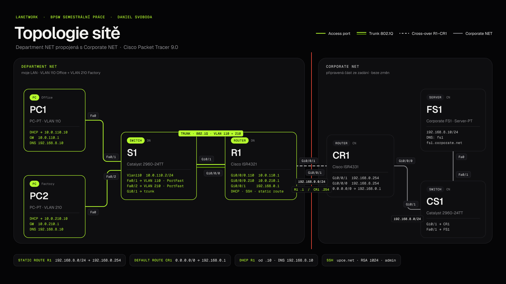
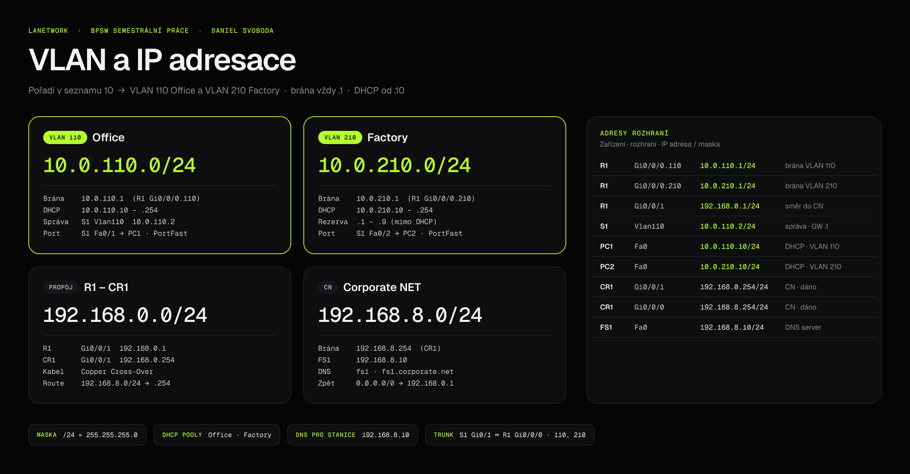

# LANetwork – semestrální práce z předmětu BPSW (Počítačové sítě)

**Zprovoznění jednoduché LAN sítě v programu Cisco Packet Tracer**

- Autor: **Daniel Svoboda**
- Předmět: BPSW – Počítačové sítě, Univerzita Pardubice, FEI
- Vyučující: Václav Hraban
- Moje pořadí v seznamu studentů: **10** → VLAN **110** (Office) a **210** (Factory)
- Program: Cisco Packet Tracer 9.0.1.0858



---

## Obsah

1. [Co je v repozitáři](#1-co-je-v-repozitáři)
2. [Slovníček pojmů a zkratek](#2-slovníček-pojmů-a-zkratek)
3. [Zadání v kostce](#3-zadání-v-kostce)
4. [VLAN a IP adresace](#4-vlan-a-ip-adresace)
5. [Zapojení – co je s čím propojené](#5-zapojení--co-je-s-čím-propojené)
6. [Postup krok za krokem](#6-postup-krok-za-krokem)
7. [Testování – jak jsem ověřil, že vše funguje](#7-testování--jak-jsem-ověřil-že-vše-funguje)
8. [Užitečné show příkazy](#8-užitečné-show-příkazy)
9. [Na co jsem si dával pozor](#9-na-co-jsem-si-dával-pozor)
10. [Kontrola splnění zadání](#10-kontrola-splnění-zadání)
11. [Dokumentace semestrální práce (Word / PDF)](#11-dokumentace-semestrální-práce-word--pdf)

---

## 1. Co je v repozitáři

```
LANetwork/
├── BPSW_Semestralni_prace_Daniel_Svoboda.pkt      ← hotová síť (odevzdává se)
├── README.md                                      ← tento návod / poznámky
├── konfigurace/
│   ├── R1_prikazy.txt                             ← příkazy, které jsem psal do CLI R1
│   ├── S1_prikazy.txt                             ← příkazy, které jsem psal do CLI S1
│   ├── R1_running-config.txt                      ← výsledná konfigurace R1 (show run)
│   └── S1_running-config.txt                      ← výsledná konfigurace S1 (show run)
├── dokumentace/
│   ├── BPSW_Semestralni_prace_Daniel_Svoboda.docx ← písemná dokumentace práce (Word)
│   └── BPSW_Semestralni_prace_Daniel_Svoboda.pdf  ← stejná dokumentace v PDF
├── obrazky/                                       ← schémata pro README a dokumentaci
└── zadani/
    ├── BPSW_Zadani_semestralni_prace.pdf          ← zadání od vyučujícího
    └── BPSW_Vychozi_topologie_CN.pkt              ← výchozí soubor z Moodle (jen CN část)
```

Odevzdání: soubor `.pkt` mailem na vaclav.hraban@upce.cz do **14. 12. 16:00**, obhajoba na cvičení **17. 12. 2026**.

---

## 2. Slovníček pojmů a zkratek

Tady jsou všechny pojmy, které se v práci objevují, vysvětlené tak, abych si je za čas rychle připomněl.

**Zařízení**

- **Router (směrovač)** – zařízení, které propojuje *různé IP sítě* a rozhoduje, kudy poslat paket dál (podle směrovací tabulky). Pracuje na 3. vrstvě (síťová, IP adresy). U mě R1 (Cisco ISR4321).
- **Switch (přepínač)** – propojuje zařízení *v rámci jedné sítě (LAN)*. Rámce posílá podle MAC adres. Pracuje na 2. vrstvě (linková). Umí rozdělit porty do VLAN. U mě S1 (Cisco Catalyst 2960-24TT).
- **Koncová stanice (host, PC)** – počítač, který síť používá. U mě PC1 a PC2.
- **Server** – počítač poskytující služby. Tady FS1 (file server), který zároveň běží jako DNS server.
- **ISR (Integrated Services Router)** – řada routerů Cisco (ISR4321, ISR4331).
- **Catalyst 2960** – řada přístupových switchů Cisco.

**Sítě a části zadání**

- **LAN (Local Area Network)** – lokální síť, např. síť jednoho oddělení nebo budovy.
- **DN (Department NET)** – moje síť oddělení (PC1, PC2, S1, R1).
- **CN (Corporate NET)** – „firemní“ síť, kterou jsme dostali hotovou (CR1, CS1, FS1). Nic se v ní nemění.
- **VLAN (Virtual LAN)** – logické rozdělení jednoho fyzického switche na více oddělených sítí. Zařízení v různých VLAN spolu bez routeru nemluví. VLAN má číslo (ID) a jméno.
- **VLAN ID** – číslo VLAN (1–4094). U mě 110 a 210.
- **Native VLAN** – VLAN, jejíž rámce jdou po trunku *bez* tagu (výchozí je VLAN 1).

**Adresace**

- **IP adresa** – adresa zařízení v síti, např. `10.0.110.10`.
- **Maska podsítě (subnet mask)** – říká, která část IP adresy je síť a která je zařízení. `255.255.255.0` = `/24`.
- **/24 (prefix, CIDR zápis)** – počet bitů masky. `/24` = prvních 24 bitů je síť, zbylých 8 bitů pro zařízení (254 použitelných adres).
- **Subnet (podsíť)** – rozsah adres, např. `10.0.110.0/24` = adresy `10.0.110.0` až `10.0.110.255`.
- **GW (Gateway, výchozí brána)** – adresa routeru ve vlastní síti. Když PC posílá něco *mimo* svou síť, pošle to na bránu. U mě vždy adresa končící `.1`.
- **MAC adresa** – fyzická (hardwarová) adresa síťové karty, např. `0090.2B12.3456`.

**Služby a protokoly**

- **DHCP (Dynamic Host Configuration Protocol)** – automatické přidělování IP adresy, masky, brány a DNS počítačům. U mě běží DHCP server přímo na routeru R1.
- **DHCP pool** – „zásobník“ adres, ze kterého DHCP rozdává (jeden pro každou VLAN).
- **Excluded address** – adresy, které DHCP *nesmí* rozdat (u mě `.1`–`.9`, aby se rozdávalo od `.10`).
- **DNS (Domain Name System)** – převádí jméno na IP adresu. Díky němu funguje `ping fs1` místo `ping 192.168.8.10`. DNS server je `192.168.8.10`.
- **Doménové jméno / FQDN** – plné jméno, např. `fs1.corporate.net`.
- **Statická cesta (static route)** – ručně zadané pravidlo „do sítě X posílej přes souseda Y“.
- **Výchozí cesta (default route)** – `0.0.0.0/0`, cesta „pro všechno ostatní“. Má ji CR1 směrem k mému R1.
- **Next hop** – adresa dalšího routeru na cestě (u mě `192.168.0.254` = CR1).
- **Ping (ICMP echo)** – test dostupnosti: pošle paket a čeká na odpověď.
- **ARP** – zjišťuje MAC adresu k IP adrese. Kvůli němu někdy první ping „vyprší“ (timeout) a další už projdou.

**Porty a přepínání**

- **Port / rozhraní (interface)** – fyzická zásuvka na zařízení, např. `GigabitEthernet0/0/0` (zkráceně Gi0/0/0) nebo `FastEthernet0/1` (Fa0/1).
- **Access port** – port switche patřící do *jedné* VLAN. Sem se připojují počítače.
- **Trunk port** – port, který přenáší *více VLAN najednou*. Rámce označuje tagem 802.1Q. Používá se mezi switchem a routerem (nebo mezi switchi).
- **802.1Q (dot1Q)** – standard pro označování (tagování) rámců číslem VLAN na trunku.
- **Subrozhraní (subinterface)** – logické „pod-rozhraní“ jednoho fyzického portu routeru, např. `Gi0/0/0.110`. Každé má vlastní VLAN a vlastní IP (bránu).
- **Router-on-a-stick** – řešení, kdy jeden fyzický port routeru obsluhuje více VLAN pomocí subrozhraní a trunku. Tak to mám zapojené já.
- **STP (Spanning Tree Protocol)** – protokol switchů proti smyčkám. Nový port nejdřív ~30 s „poslouchá“, než začne přenášet data.
- **PortFast** – funkce STP, která port pro koncovou stanici zapne okamžitě (bez čekání). Patří **jen na access porty k počítačům**, nikdy na trunk.
- **SVI (Switch Virtual Interface)** – virtuální rozhraní switche ve VLAN (`interface Vlan110`). Dává switchi IP adresu pro správu.
- **Management (správa)** – přístup na zařízení přes síť kvůli konfiguraci.

**Zabezpečení a správa**

- **CLI (Command Line Interface)** – příkazová řádka zařízení Cisco.
- **IOS** – operační systém zařízení Cisco.
- **User EXEC (`R1>`)**, **Privileged EXEC (`R1#`)**, **Global config (`R1(config)#`)** – režimy CLI. Do privilegovaného se jde příkazem `enable`, do konfigurace `configure terminal`.
- **Enable secret** – heslo do privilegovaného režimu (ukládá se zahashované).
- **service password-encryption** – zašifruje i ostatní hesla v konfiguraci (např. hesla linek), aby nebyla vidět v čitelné podobě.
- **VTY (Virtual Terminal) linky** – „virtuální terminály“ pro vzdálené připojení (Telnet/SSH). `line vty 0 4` = 5 současných relací.
- **SSH (Secure Shell)** – šifrované vzdálené připojení do CLI. Bezpečná náhrada Telnetu.
- **Telnet** – nešifrované vzdálené připojení (nepoužívám, je zakázané).
- **RSA klíč** – kryptografický klíč, který SSH potřebuje. Generuje se `crypto key generate rsa`, délka 1024 bitů.
- **ip domain-name** – doménové jméno zařízení. Je potřeba pro vygenerování RSA klíče (klíč se jmenuje `R1.upce.net`).
- **login local** – přihlášení ověřuje lokální uživatele (`username admin ...`).
- **transport input ssh** – na VTY linkách povolí jen SSH.
- **running-config** – aktuální konfigurace v RAM. **startup-config** – uložená konfigurace v NVRAM (načte se po restartu). Ukládá se `copy running-config startup-config` (nebo `wr`).

---

## 3. Zadání v kostce

- 1× router **R1** (ISR4321), 1× switch **S1** (2960-24TT), 2× PC (**PC1**, **PC2**).
- Na S1 dvě VLAN: **110 Office** a **210 Factory**, každé PC v jiné VLAN (access port).
- S1 je k R1 připojen **trunkem**, PortFast **jen** na portech k PC.
- R1 je výchozí brána obou VLAN, rozdává adresy přes **DHCP** (od `.10`) a jako DNS dává `192.168.8.10`.
- R1 je připojený portem **Gi0/0/1** na **Gi0/0/1** routeru CR1 a má **statickou cestu** do sítě CN `192.168.8.0/24`.
- Musí fungovat `ping` z PC na sebe navzájem, na bránu a na FS1 – na IP `192.168.8.10` i na jméno `fs1` a `fs1.corporate.net`.
- **Bezpečnost**: SSH na R1 i S1, doména `upce.net`, RSA 1024 bitů, uživatel `admin`/`cisco`, enable heslo `cisco`, hesla šifrovaná, VTY jen SSH + lokální login. S1 má pro správu `interface Vlan110` s adresou `10.0.110.2/24`.

---

## 4. VLAN a IP adresace



VLAN na S1:

| VLAN | Jméno | Síť | Brána (R1) | Porty S1 |
|---|---|---|---|---|
| 110 | Office | 10.0.110.0/24 | 10.0.110.1 | Fa0/1 (PC1) |
| 210 | Factory | 10.0.210.0/24 | 10.0.210.1 | Fa0/2 (PC2) |

IP adresy zařízení:

| Zařízení | Rozhraní | IP adresa / maska | Poznámka |
|---|---|---|---|
| R1 | Gi0/0/0.110 | 10.0.110.1/24 | brána VLAN 110 |
| R1 | Gi0/0/0.210 | 10.0.210.1/24 | brána VLAN 210 |
| R1 | Gi0/0/1 | 192.168.0.1/24 | směr do CN |
| S1 | Vlan110 | 10.0.110.2/24 | správa (SSH), GW 10.0.110.1 |
| PC1 | Fa0 | DHCP → 10.0.110.10 | GW 10.0.110.1, DNS 192.168.8.10 |
| PC2 | Fa0 | DHCP → 10.0.210.10 | GW 10.0.210.1, DNS 192.168.8.10 |
| CR1 | Gi0/0/1 | 192.168.0.254/24 | (CN – dáno) |
| CR1 | Gi0/0/0 | 192.168.8.254/24 | (CN – dáno) |
| FS1 | Fa0 | 192.168.8.10/24 | DNS server (CN – dáno) |

DHCP rozdává adresy od `.10`, protože `.1`–`.9` jsou vyloučené (`.1` brána, `.2` switch, zbytek rezerva).

---

## 5. Zapojení – co je s čím propojené

Použil jsem dva typy měděných kabelů:

- **Přímý kabel (Copper Straight-Through)** – v PT černá plná čára. Používá se mezi *různými* typy zařízení: PC–switch, switch–router.
- **Křížený kabel (Copper Cross-Over)** – v PT černá přerušovaná čára. Používá se mezi *stejnými* typy zařízení, tady router–router.

Propojení:

- **PC1 Fa0 ↔ S1 Fa0/1** – přímý, access port, VLAN 110 Office
- **PC2 Fa0 ↔ S1 Fa0/2** – přímý, access port, VLAN 210 Factory
- **S1 Gi0/1 ↔ R1 Gi0/0/0** – přímý, trunk (nese VLAN 110 a 210)
- **R1 Gi0/0/1 ↔ CR1 Gi0/0/1** – křížený, propoj do Corporate NET (192.168.0.0/24)
- (CN, už bylo zapojené) CR1 Gi0/0/0 ↔ CS1 Gi0/1, CS1 Fa0/1 ↔ FS1 Fa0

Ikony CN části jsem v logickém pohledu jen posunul doprava, aby se moje síť vešla vlevo jako ve schématu zadání. Konfiguraci CN jsem neměnil.

---

## 6. Postup krok za krokem

### Příprava souboru a zařízení

1. Otevřel jsem výchozí soubor z Moodle (`zadani/BPSW_Vychozi_topologie_CN.pkt`) a uložil ho pod novým jménem `BPSW_Semestralni_prace_Daniel_Svoboda.pkt`.
2. Z dolní lišty jsem přidal:
   - **Network Devices → Routers → ISR4321** → R1
   - **Network Devices → Switches → 2960** → S1
   - **End Devices → PC** → 2× (PC1, PC2)
3. Každé zařízení jsem přejmenoval (kliknout na zařízení → záložka **Config** → *Display Name*). Hostname na R1/S1 nastavuji příkazem `hostname` v CLI.

### Kabeláž

Nástroj **Connections (blesk) → Copper Straight-Through** (pro R1–CR1 **Copper Cross-Over**), pak kliknout na zařízení a vybrat port. Zapojení viz [kapitola 5](#5-zapojení--co-je-s-čím-propojené). Po zapojení jsou kontrolky oranžové (STP) a po chvíli zelené. Kontrolky k R1 jsou červené, dokud na routeru nedám `no shutdown` (porty routeru jsou ve výchozím stavu vypnuté).

### Konfigurace switche S1

Kliknout na S1 → záložka **CLI**. Celé příkazy jsou v [`konfigurace/S1_prikazy.txt`](konfigurace/S1_prikazy.txt). Po částech:

**Základ a hesla**
```
enable
configure terminal
hostname S1
enable secret cisco
service password-encryption
no ip domain-lookup
```
`no ip domain-lookup` jen zabrání tomu, aby se switch při překlepu snažil hledat příkaz jako jméno v DNS (jinak CLI na chvíli „zamrzne“).

**VLAN**
```
vlan 110
 name Office
vlan 210
 name Factory
```

**Access porty pro PC + PortFast**
```
interface FastEthernet0/1
 description PC1 - Office
 switchport mode access
 switchport access vlan 110
 spanning-tree portfast
interface FastEthernet0/2
 description PC2 - Factory
 switchport mode access
 switchport access vlan 210
 spanning-tree portfast
```

**Trunk k routeru** (tady PortFast NENÍ)
```
interface GigabitEthernet0/1
 description Trunk do R1
 switchport mode trunk
 switchport trunk allowed vlan 110,210
```
`allowed vlan 110,210` – po trunku pustím jen moje dvě VLAN.

**Správa switche**
```
interface Vlan110
 ip address 10.0.110.2 255.255.255.0
 no shutdown
ip default-gateway 10.0.110.1
```
`ip default-gateway` je nutná, aby switch odpověděl i zařízením z jiné sítě (např. na SSH z PC2 ve VLAN 210).

### Konfigurace routeru R1

Kliknout na R1 → **CLI**. Celé příkazy v [`konfigurace/R1_prikazy.txt`](konfigurace/R1_prikazy.txt).

**Základ a hesla**
```
enable
configure terminal
hostname R1
enable secret cisco
service password-encryption
no ip domain-lookup
```

**Router-on-a-stick – trunk a subrozhraní pro VLAN**
```
interface GigabitEthernet0/0/0
 no shutdown
interface GigabitEthernet0/0/0.110
 encapsulation dot1Q 110
 ip address 10.0.110.1 255.255.255.0
interface GigabitEthernet0/0/0.210
 encapsulation dot1Q 210
 ip address 10.0.210.1 255.255.255.0
```
Fyzický port nemá IP, jen se zapne. Každé subrozhraní má `encapsulation dot1Q <VLAN>` (musí být *před* IP adresou) a IP brány dané VLAN.

**Propoj do CN**
```
interface GigabitEthernet0/0/1
 ip address 192.168.0.1 255.255.255.0
 no shutdown
```

**DHCP server**
```
ip dhcp excluded-address 10.0.110.1 10.0.110.9
ip dhcp excluded-address 10.0.210.1 10.0.210.9
ip dhcp pool Office
 network 10.0.110.0 255.255.255.0
 default-router 10.0.110.1
 dns-server 192.168.8.10
ip dhcp pool Factory
 network 10.0.210.0 255.255.255.0
 default-router 10.0.210.1
 dns-server 192.168.8.10
```
Excluded-address je dobré zadat *před* pooly. `default-router` = brána, kterou PC dostane, `dns-server` = DNS, který PC dostane.

**Statická cesta do CN**
```
ip route 192.168.8.0 255.255.255.0 192.168.0.254
```
Čtu to: „do sítě 192.168.8.0/24 posílej přes 192.168.0.254 (CR1)“. Cesta zpátky už v CN existuje – CR1 má výchozí cestu `0.0.0.0/0 → 192.168.0.1` (můj R1), takže odpovědi do sítí 10.0.x.0 dorazí.

### Nastavení PC1 a PC2

Kliknout na PC → **Desktop → IP Configuration** → přepnout na **DHCP**. Po chvíli se objeví „DHCP request successful“ a PC dostane:

- PC1: IP `10.0.110.10`, maska `255.255.255.0`, brána `10.0.110.1`, DNS `192.168.8.10`
- PC2: IP `10.0.210.10`, maska `255.255.255.0`, brána `10.0.210.1`, DNS `192.168.8.10`

Pokud se adresa nepřidělí (169.254.x.x nebo prázdné), přepnout na Static a zpět na DHCP.

### Zabezpečení přes SSH (R1 i S1)

Stejné příkazy na obou zařízeních (v konfiguračním režimu):
```
ip domain-name upce.net
username admin secret cisco
crypto key generate rsa
   How many bits in the modulus [512]: 1024
ip ssh version 2
```
VTY linky na **R1** (ISR4321 má linky 0–4):
```
line vty 0 4
 password cisco
 login local
 transport input ssh
```
VTY linky na **S1** (2960 má linky 0–15):
```
line vty 0 15
 password cisco
 login local
 transport input ssh
```
- `enable secret cisco` (viz konfigurace S1 a R1) = heslo pro enable režim.
- `password cisco` na VTY + `service password-encryption` = heslo pro VTY, v konfiguraci je zašifrované (`password 7 ...`).
- `login local` = při přihlášení se ptá na uživatele `admin` a jeho heslo.
- `transport input ssh` = Telnet je zakázaný, jde jen SSH.
- Bez `ip domain-name` RSA klíč nejde vygenerovat (klíč se pojmenuje `R1.upce.net` / `S1.upce.net`).
- `ip ssh version 2` – po vygenerování klíče 1024 bitů je možné zapnout novější SSH verze 2.

### Uložení

Na R1 i S1:
```
end
copy running-config startup-config
```
(nebo krátce `wr`). Pak **File → Save** v Packet Traceru.

---

## 7. Testování – jak jsem ověřil, že vše funguje

Testy jsem dělal z **PC → Desktop → Command Prompt**. Před testy je dobré chvíli počkat (nebo několikrát kliknout na **Fast Forward Time** dole), aby doběhlo DHCP a STP. První ping může mít 1 timeout kvůli ARP – to je normální.

**Test 1 – PC dostalo adresu z DHCP**
```
PC1> ipconfig /all
```
Očekávám IP `10.0.110.10`, Default Gateway `10.0.110.1`, DNS Servers `192.168.8.10`. Na PC2 stejně s `10.0.210.x`.

**Test 2 – ping na výchozí bránu**
```
PC1> ping 10.0.110.1
PC2> ping 10.0.210.1
```

**Test 3 – ping mezi PC (přes router, mezi VLAN)**
```
PC1> ping 10.0.210.10
PC2> ping 10.0.110.10
```

**Test 4 – ping do Corporate NET na IP**
```
PC1> ping 192.168.8.10
PC2> ping 192.168.8.10
```
Ověřuje statickou cestu na R1 i zpáteční cestu na CR1.

**Test 5 – ping na jméno (DNS)**
```
PC1> ping fs1
PC1> ping fs1.corporate.net
```
Ve výpisu je vidět „Pinging 192.168.8.10“ – jméno se přeložilo přes DNS server 192.168.8.10. Totéž z PC2.

**Test 6 – SSH na switch a router**
```
PC1> ssh -l admin 10.0.110.2
Password: cisco
S1> enable
Password: cisco
S1#

PC2> ssh -l admin 10.0.110.1
Password: cisco
R1> enable
Password: cisco
R1#
```
Pro jistotu i negativní test – Telnet musí selhat:
```
PC1> telnet 10.0.110.1
```
(spojení se odmítne, protože VTY povolují jen SSH).

**Test 7 – kontrola na zařízeních** – viz další kapitola (`show vlan brief`, `show interfaces trunk`, `show ip dhcp binding`, `show ip route`, `show ip ssh`).

**Alternativně v simulaci:** ikona obálky (**Add Simple PDU**) – kliknout na PC1 a pak na FS1, v pravém dolním panelu musí být *Successful*.

---

## 8. Užitečné show příkazy

Na **S1**:
```
show vlan brief              ← VLAN 110 Office (Fa0/1), VLAN 210 Factory (Fa0/2)
show interfaces trunk        ← Gi0/1 v režimu trunk, povolené VLAN 110,210
show interfaces status       ← stav portů
show running-config interface fa0/1   ← vidím spanning-tree portfast
show ip interface brief      ← Vlan110 10.0.110.2 up/up
show ip ssh                  ← SSH Enabled - version 2.0
show running-config
```
Na **R1**:
```
show ip interface brief      ← Gi0/0/0, Gi0/0/0.110, .210, Gi0/0/1 up/up
show ip route                ← C 10.0.110.0, C 10.0.210.0, C 192.168.0.0, S 192.168.8.0 [1/0] via 192.168.0.254
show ip dhcp binding         ← přidělené adresy PC1 a PC2
show ip dhcp pool
show ip ssh
show users                   ← kdo je zrovna přihlášený přes SSH
show running-config
```

---

## 9. Na co jsem si dával pozor

Tohle **nejsou chyby v mém projektu** – v síti je všechno nastavené správně. Jsou to místa, kde se při takové konfiguraci často chybuje, takže je dobré je při opakování nebo hledání problému zkontrolovat jako první.

- **Porty routeru jsou ve výchozím stavu vypnuté** – bez `no shutdown` na Gi0/0/0 a Gi0/0/1 nic nefunguje.
- **`encapsulation dot1Q` musí být před `ip address`** na subrozhraní, jinak IP nejde zadat.
- **PortFast nedávat na trunk** – jen na porty k PC.
- **Číslo VLAN na switchi a na subrozhraní routeru musí sedět** (110 ↔ .110, 210 ↔ .210).
- **Bez `ip domain-name` nejde vygenerovat RSA klíč** a bez klíče nefunguje SSH.
- **Switch bez `ip default-gateway`** neodpoví na SSH z jiné VLAN.
- **DHCP dává adresu až od .10** – kvůli `excluded-address`. Adresa S1 `.2` je ve vyloučeném rozsahu, takže se nemůže stát, že ji DHCP přidělí PC.
- **Ping na jméno nefunguje, ale na IP ano** → PC nemá DNS (zkontrolovat `dns-server` v DHCP poolu a obnovit DHCP na PC).
- **Ping do CN nefunguje** → zkontrolovat `show ip route` na R1 (musí tam být řádek `S 192.168.8.0/24`).
- **Po zavření PT** se ztratí neuložená konfigurace – vždy `wr` a uložit soubor.

---

## 10. Kontrola splnění zadání

- [x] Router R1 (ISR4321), hostname R1
- [x] Switch S1 (2960-24TT), hostname S1
- [x] 2 koncové stanice PC1, PC2
- [x] VLAN 110 Office, VLAN 210 Factory
- [x] PC1 ve VLAN 110 (Fa0/1), PC2 ve VLAN 210 (Fa0/2), access porty
- [x] S1 připojen k R1 přes trunk (Gi0/1 ↔ Gi0/0/0)
- [x] PortFast jen na portech pro PC
- [x] Brány 10.0.110.1 a 10.0.210.1 (adresa končí .1)
- [x] DHCP na R1 od adresy .10, DNS 192.168.8.10 v DHCP
- [x] R1 Gi0/0/1 = 192.168.0.1/24 připojen na CR1 Gi0/0/1
- [x] Statická cesta do 192.168.8.0/24 přes 192.168.0.254
- [x] Ping PC ↔ PC, PC → brána, PC → 192.168.8.10, fs1, fs1.corporate.net
- [x] S1 Vlan110 = 10.0.110.2/24 pro správu
- [x] ip domain-name upce.net, RSA 1024 bitů, uživatel admin/cisco
- [x] enable heslo cisco, VTY heslo cisco, hesla zašifrovaná
- [x] VTY: transport input ssh + login local
- [x] SSH z PC na S1 a R1
- [x] CN část beze změny konfigurace

---

## 11. Dokumentace semestrální práce (Word / PDF)

Kompletní písemná dokumentace je ve složce [`dokumentace/`](dokumentace/):

- 📄 [BPSW_Semestralni_prace_Daniel_Svoboda.docx](dokumentace/BPSW_Semestralni_prace_Daniel_Svoboda.docx) – Word (ke stažení a úpravám)
- 📕 [BPSW_Semestralni_prace_Daniel_Svoboda.pdf](dokumentace/BPSW_Semestralni_prace_Daniel_Svoboda.pdf) – PDF (dá se prohlédnout přímo na GitHubu)

Dokumentace má 27 stran a obsahuje:

- úvod a zadání semestrální práce,
- slovníček základních pojmů a zkratek,
- návrh topologie, zapojení kabelů a adresní plán (VLAN, IP),
- postup konfigurace krok za krokem s vysvětlením každého příkazu,
- zabezpečení přes SSH,
- testování (ping, DNS, SSH) a použité show příkazy,
- přehled splnění zadání, závěr, seznam zkratek, obrázků a tabulek.
